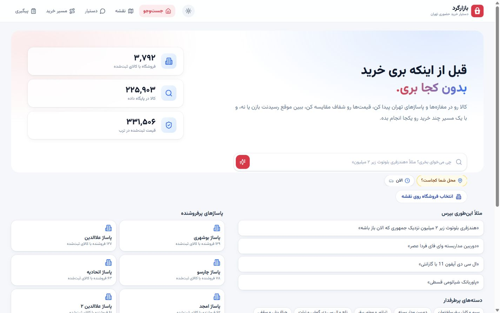

# بازارگرد | Bazargard

A Persian, right-to-left shopping assistant for buying in person from Tehran stores and shopping malls, built for the Torob hackathon.



## What it does

- Understand product, budget, neighborhood and visit-time requirements in Persian.
- Search actual product offers, with editable filters and clear recommendation reasons.
- Compare products or select two to three sellers for the same product. Each seller column uses one exact offer for its price, warranty and status.
- Keep shopping requirements across search, product pages, chat and alternatives.
- Select a precise starting point and tap stores on a map.
- Prepare stock inquiries and track replies. SMS and voice run in simulation by default.
- Plan store visits with estimated arrival times, opening-hour warnings, mall floors and units.
- Show neighboring stores as arrival landmarks and offer alternatives after an unsuccessful visit.
- Record purchase outcomes and preserve an in-progress visit guide.

## Run locally

Requires Python 3.12 or newer (tested with 3.14), Node.js 22, and the challenge dataset. Run commands from the repository root.

```sh
python -m venv backend/.venv
# macOS / Linux
source backend/.venv/bin/activate
# Windows PowerShell: backend\.venv\Scripts\Activate.ps1
python -m pip install -r backend/requirements.txt
npm --prefix frontend ci
```

Copy `.env.example` to `.env`. Its defaults are for local development and simulated communication. The assistant also works without LLM credentials, using the Persian query parser.

Place `shops.csv`, `products.csv` and `offers.csv` from the official Torob challenge download in `dataset/`. The supplied dataset and generated catalog are deliberately excluded from Git.

```sh
python backend/manage.py migrate
python backend/manage.py build_catalog --src dataset
npm --prefix frontend run build
python backend/manage.py runserver 127.0.0.1:8000
```

Open <http://localhost:8000>. Django serves both `/api` and the built frontend. For frontend hot reload, keep Django running and use `npm --prefix frontend run dev` at <http://localhost:5173>.

## Checks

The regression tests use isolated fixtures and do not require the supplied dataset or external LLM/SMS services.

```sh
npm --prefix frontend test
npm --prefix frontend run build
python backend/manage.py test catalog.test_neighbors catalog.test_shopping_ux catalog.test_mapshops catalog.test_context --noinput
```

## Data and demo boundaries

The challenge provides 6,476 shops, 225,903 products and 331,506 offers. Most shop names and all phone numbers are synthetic. Coordinates are real. The dataset covers selected parts of Tehran and does not represent every local store.

A listed offer is not confirmed inventory. The app shows listed-price age separately from stock reports. A shop's activity category does not prove it sells a particular product. Unknown payment channels, hours and warranties remain unknown unless explicitly included in filters.

For a safe demo, keep `SMS_PROVIDER=simulated` and `VOICE_PROVIDER=simulated`. No seller communication is delivered in those modes. Real automatic voice delivery requires implementing a provider adapter. Real SMS needs a supported provider and an approved test recipient rather than a dataset phone number.

Travel times and routes are heuristic estimates. The app does not provide live traffic or indoor turn-by-turn navigation. The route cache supports an already-loaded guide; this project does not currently install a PWA service worker.

## Structure

```text
backend/catalog/       Search, assistant, seller follow-up, routing and API
backend/config/        Django settings and routes
frontend/src/          React, TypeScript, RTL UI and maps
frontend/tests/        Frontend behavioral regressions
dataset/               Bring the official challenge CSVs here
demo/                  Persian narration and demo storyboard
plan.md                Product decisions and implementation notes
```

## Demo material

The narrated five-minute demo is being prepared. Storyboard and narration sources live in `demo/`; generated media and isolated demo databases stay local. No completed video or public deployment is claimed by this repository.

## Configuration and publication

`.env`, SQLite databases, virtual environments, downloaded data and local build files are ignored. `.env.example` contains placeholders only. Before a public server deployment, provide a strong `DJANGO_SECRET_KEY`, disable debug mode, configure allowed hosts/CSRF origins and use a production server with HTTPS. The local `runserver` command is for development.

The dataset remains subject to the challenge provider's terms and is not redistributed here. This repository does not grant additional rights to that dataset or third-party product images.
